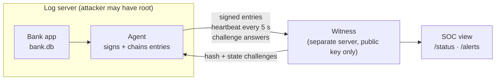

# Chain of Custody

**Logs that prove they weren't changed, catch the intruder in the act, and lock the door behind them.**

Hackurity 2026 · PS-6 · Team Firewall Crew

An insider with admin access on a bank server can edit a balance and then edit the logs to hide it. The logs sit on the same machine as the attacker, so most tools never notice. Chain of Custody moves the proof **off the machine**: every log entry is signed, chained and checked by an outside **witness** the attacker can't reach. Tampering is **detected and provable**, and every alert says **what kind** of tampering happened.

---

## How it works



### Three layers

| Layer | What it does | Status |
|---|---|---|
| **Layer 2 · Heartbeat + checksum** | Detects tampering and names what kind | ✅ Built |
| **Layer 1 · Command tripwire** | Catches the intruder in the act: `nano app.log` opens a decoy, the real log is untouched, and what they tried to change is captured | ✅ Built · auditd backstop next |
| **Layer 3 · Break glass** | Last resort: capture evidence, isolate, freeze, unlock only with 2-of-3 key holders. Never reboots. | 🛠 Planned |

### Layer 2 checks

| Check | Question it answers | How |
|---|---|---|
| **A · Sealed chain** | Was anything changed? | Every entry is SHA-256 hashed, linked to the previous one and signed with Ed25519. The witness re-hashes everything it holds every 5 s. |
| **B · Outside witness** | Is the agent alive and honest? | Signed heartbeat every 5 s (silence after 15 s), random hash challenges, timestamps that only move forward. |
| **C · Truth check** | Does the log match the bank's real state? | The witness replays every balance itself and asks the agent for a real balance at random times. This catches a **direct database edit with no log entry**, which a hash chain alone never sees. |

### What the SOC sees: tamper types

| `tamper_type` | Meaning |
|---|---|
| `entry_edited` | A stored entry no longer matches its hash |
| `entry_deleted` | A `seq` gap: an entry is missing |
| `entries_reordered` | Entries out of order, links swapped |
| `entry_replayed` | The same entry or heartbeat sent twice |
| `entry_inserted` | An extra entry that doesn't fit the chain |
| `backdated` | A timestamp earlier than the last accepted one |
| `forged` | Bad signature or unknown key |
| `agent_silenced` | No heartbeat, or a challenge went unanswered |
| `balance_misreported` | A reported balance differs from the witness's replay |
| `db_edited_without_log` | The bank's real balance differs, while the chain stays green |

---

## Quick start (one laptop, no Docker)

Needs Python 3.11 or newer.

```bash
git clone https://github.com/JeevikaS-19/cybersec.git
cd cybersec
python -m venv .venv
.venv\Scripts\activate            # macOS/Linux: source .venv/bin/activate
pip install -r requirements.txt
```

Open three terminals (activate the venv in each):

```bash
# 1 · Witness
python -m uvicorn --factory witness.app:create_app --port 8000

# 2 · Fake bank: one transfer per second into bank.db
python victim/bank.py

# 3 · Agent: reads bank.db, signs, sends to the witness
python agent/agent.py
```

Check it's healthy:

```bash
curl http://127.0.0.1:8000/status     # {"checks": {"A": "green", "B": "green", "C": "green"}, "state": "normal", ...}
curl http://127.0.0.1:8000/alerts
```

### Try an attack

| Attack | Do this | You'll see |
|---|---|---|
| Kill the agent | Stop terminal 3 | Check B red, `agent_silenced` within ~15 s |
| Edit a balance with no log | `sqlite3 bank.db "UPDATE accounts SET balance_paise = balance_paise + 1000000 WHERE account_id='acc-1'"` | Check C red, A and B stay green |

For a faster demo, set the env var `CHALLENGE_CHANCE=1.0` before starting the witness so it challenges every poll.

### Run the witness on a separate machine

The witness is meant to live outside the log server. On the second machine run the witness with `--host 0.0.0.0` and allow port 8000 through the firewall. On the log server, before starting the agent:

```bash
set WITNESS_URL=http://<witness-ip>:8000       # PowerShell: $env:WITNESS_URL="http://<witness-ip>:8000"
```

---

## Plugging in another platform

The agent is a small sidecar process. A platform plugs in by giving it its transactions and balances; nothing in the platform itself changes.

1. **Point the agent at your data.** Set `BANK_DB_PATH`, and map your transaction rows to the entry fields in `agent/agent.py` (`sync_bank`). The agent needs, per transaction: `txn_id`, `timestamp`, `from_account`, `to_account`, `amount_paise` and the balances after the transaction, `from_balance_paise` and `to_balance_paise`. Amounts are **integer paise**, never floats.
2. **Answer balance questions.** For Check C the agent must read an account's real balance from your system (`bank_balance_at`).
3. **Give it an identity.** Set `PLATFORM_ID` (default `log-server-1`). The agent creates its own Ed25519 key, registers its public key with the witness (`POST /register/agent`) and keeps the private key locally. The private key is never sent or printed.
4. **Point it at the witness.** Set `WITNESS_URL`.

Each platform gets its own independent chain, so one witness can serve many platforms.

| Env var | Used by | Default |
|---|---|---|
| `WITNESS_URL` | agent | `http://127.0.0.1:8000` |
| `BANK_DB_PATH` | bank, agent | `bank.db` |
| `AGENT_DB_PATH` | agent (local copy of every entry) | `agent_state.db` |
| `PLATFORM_ID` | agent | `log-server-1` |
| `WITNESS_DB_PATH` | witness | `witness.db` |

Every check and layer can be switched on or off in `config/layers.yaml`.

### Witness API

| Route | Purpose |
|---|---|
| `POST /register/agent` | Register a platform's public key, returns `key_id` |
| `POST /entries` | Submit a signed, chained entry |
| `POST /heartbeat` | Signed heartbeat every 5 s |
| `GET /challenge/poll` · `POST /challenge/response` | Hash and state challenges |
| `GET /status` | Checks A to C, layers, state (normal / alert / frozen) |
| `GET /alerts` | Every alert with its `tamper_type` |
| `GET /verify?from_seq=&to_seq=` | Re-verify a range of the chain |

---

## Tests

```bash
python -m pytest -q -m "not slow and not docker"   # fast suite
python -m ruff check .
```

## Honest limits

- The witness learns each account's opening balance from the first entry it sees, so setup must happen on a clean system.
- An attacker who steals the agent's private key can keep signing heartbeats; Check C still catches balance changes.
- If the network is cut, the witness sees the silence. The agent queues entries and resends them with the same `seq` when the network is back.

## Roadmap

Docker compose with a no-SSH witness container, write-once evidence vault (MinIO object lock), Layer 1 tripwire with auditd, Layer 3 break glass with Shamir 2-of-3 unlock, SOC and auditor dashboard.
