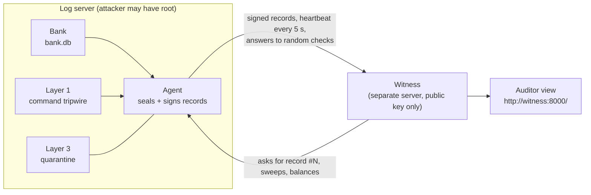

# Chain of Custody

**Logs that prove they weren't changed, catch the intruder in the act, and lock the door behind them.**

Hackurity 2026 · PS-6 · Team Firewall Crew

An insider with admin access on a bank server can edit a balance and then edit the logs to hide it. The logs sit on the same machine as the attacker, so most tools never notice. Chain of Custody moves the proof **off the machine**: every record is signed, chained and checked by an outside **witness** the attacker can't reach. Tampering is **detected and provable**, and every alert says **what kind** of tampering happened. The bank's own screens show nothing; alerts appear only on the witness's auditor view.



## Three layers

| Layer | What it does |
|---|---|
| **Layer 2 · Heartbeat + checksum** | Every bank transaction becomes a sealed record (SHA-256 chain + Ed25519 signature) held by the witness. The witness asks for random records (`#42`) and sweeps all of them, comparing the bank's row **now** with the sealed copy, field by field. **Check A** sealed chain, **Check B** heartbeat + challenges, **Check C** the witness replays every balance and asks for real ones. Every alert names its `tamper_type`. |
| **Layer 1 · Command tripwire** | The team runs guarded commands with its platform's secret profile-id: `nano --<profile-id> app.log` (allowed, logged). An intruder types plain `nano`: in **deception mode** they edit a decoy, the real log is never touched, and the change they tried to make is captured. Guarded commands and paths come from config. |
| **Layer 3 · Quarantine** | If the server loses the witness for 45 s (the attacker cut the network), it quarantines itself: capture evidence → seal locally → site down → lock out every user including root → QUARANTINED. Never reboots. It keeps sealing records, reports in when the network is back and stays locked until **2 of 3 key holders** approve; the witness then signs the unlock. |

## Run the demo (one command)

Needs Python 3.11+. Layer 1 runs in WSL Ubuntu (or any Linux).

```bash
git clone https://github.com/JeevikaS-19/cybersec.git && cd cybersec
python -m venv .venv && .venv\Scripts\activate      # macOS/Linux: source .venv/bin/activate
pip install -r requirements.txt
python demo/demo.py
```

It starts a fresh witness, fake bank and agent, opens the auditor view at **http://127.0.0.1:8000/**, and gives you a menu:

| Key | Attack | What the auditor view shows |
|---|---|---|
| 1 | Intruder edits the log with `vim` (no profile-id) | Layer 1 caught: command log, rule broken, the attempted diff; real log untouched |
| 2 | Admin edits with `vim --<profile-id>` | Allowed row in the command log, no alert |
| 3 | Attacker edits a transaction row in `bank.db` | Layer 2 caught: **Record #N**, expected vs found, changed field in red |
| 4 | Attacker changes a balance with no transaction | Check C: `db_edited_without_log` |
| 5 | Cut the network | Flat heartbeat, then Layer 3: "Banking server has quarantined itself" |
| 6 | Plug it back in | Server reports the records sealed during the cut; press **Approve** twice to unlock |
| r | Reset everything | |

## Attach to another platform

The agent is a sidecar; the platform's code doesn't change. Everything is set in `config/layers.yaml` and env vars:

| Setting | Where |
|---|---|
| Witness address | `WITNESS_URL` |
| Bank database | `BANK_DB_PATH` (PostgreSQL adapter: next) |
| Platform name | `PLATFORM_ID` |
| Team profile-id | `python -m layers.l1_tripwire.profiles add <platform>` (stored as a hash) |
| Guarded commands, protected paths, deception/block | `layer1` |
| Heartbeat, silence alarm, check rates, sweep | `layer2` |
| Quarantine time, lockout/site-down commands, key holders | `layer3` (`dry_run: false` on a real server) |
| Install the tripwire | `sudo sh layers/l1_tripwire/install.sh` |

Run the pieces yourself: `python -m uvicorn --factory witness.app:create_app --port 8000` (witness), `python agent/agent.py` (agent, on the log server).

## Witness API

| Route | Purpose |
|---|---|
| `POST /register/agent` | Register a platform's public key; returns `key_id` and the witness's public key |
| `POST /entries` · `POST /heartbeat` | Signed records and heartbeats |
| `GET /challenge/poll` · `POST /challenge/response` | Random checks: latest hash, balance, record #N, sweep |
| `POST /events` · `GET /timeline` | Layer 1/3 events, signed by the agent |
| `POST /quarantine/report` · `/quarantine/approve` · `GET /quarantine/poll` | Layer 3 |
| `GET /status` · `/alerts` · `/mismatches` · `/activity` | Auditor view data; `GET /` is the auditor view |

Full contract: `MD_FILES/06-api-contract.md`.

## Tests

```bash
python -m pytest -q -m "not slow and not docker"   # 46 fast tests
python -m pytest -q -m slow                        # T0: 10,000 transactions, zero alerts
bash layers/l1_tripwire/smoke.sh                   # Layer 1 in Linux/WSL
python -m ruff check .
```

## Honest limits

- The witness learns each account's opening balance from the first record it sees, so setup must happen on a clean system.
- A full-path command (`/usr/bin/nano`) bypasses the wrappers; the auditd backstop is next.
- An attacker who steals the agent's key can keep sending heartbeats; record checks and Check C still catch changes to the bank's data.
- Whoever controls the hypervisor or console can always get in. Approvals are buttons for the demo; production uses Shamir 2-of-3 shares.
- On the demo laptop the quarantine lockout runs in dry-run mode (commands recorded); a Linux container runs them for real.
